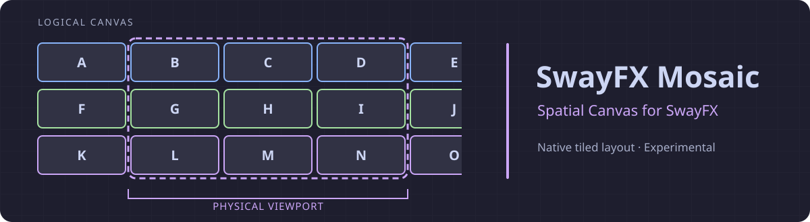
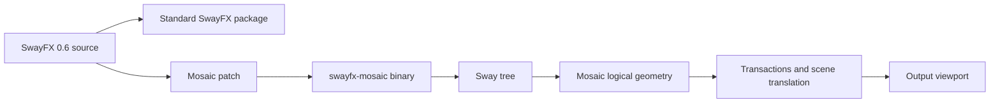

<p align="center">
  
</p>

<h1 align="center">SwayFX Mosaic</h1>

<p align="center">Native Spatial Canvas layout for SwayFX.</p>

<p align="center">
  
  
  
  <a href="LICENSE"></a>
</p>

<p align="center">
  <a href="#overview">Overview</a> · <a href="#the-idea">Concept</a> · <a href="#current-status">Status</a> · <a href="#architecture">Architecture</a> · <a href="#layout-switching">Usage</a> · <a href="#development">Development</a> · <a href="#documentation">Documentation</a> · <a href="docs/ROADMAP.md">Roadmap</a>
</p>

## Overview

SwayFX Mosaic adds an experimental **native Spatial Canvas layout** to [SwayFX](https://github.com/WillPower3309/swayfx). A tiled row can extend beyond the physical viewport while the compositor remains authoritative for geometry, focus, input, and state.

Windows remain real Sway tiled containers. Mosaic is neither a floating-window simulation nor a QuickShell layout engine. It exists because a spatial layout needs the compositor's tiling tree, transactions, scene, and input model. The current implementation is a development foundation, not a validated daily-driver session.

## The idea

```text
Logical workspace / Row 0
[A][B][C][D][E]...
       └── visible viewport ──┘

Future rows
[F][G][H][I]...    [J][K]...
```

A workspace contains a Canvas; the intended Canvas contains ordered rows, each with tiled containers, a camera position (`scroll_x`), and remembered focus. **Logical order** says which container follows which. **Geometry** gives each container a logical rectangle. The **viewport** shows part of that geometry. **Focus** selects the active container and may move the viewport without changing order. Only Row 0 is connected to runtime layout today.

## Why the compositor?

Fake workspaces, all-floating windows, and a `swaymsg` repositioning daemon would make a second layout authority. QuickShell can visualize Mosaic later, but does not own layout. SwayFX has no stable external layout plugin ABI; injecting a runtime `.so` is not this project's model. Mosaic belongs in the compositor because it already owns tiling, transactions, rendering, focus, and input.

## Current status

`CURRENT` means present in the development tree; `EXPERIMENTAL` means present but not validated for general use. See [known limitations](docs/KNOWN_LIMITATIONS.md).

| Capability | Status |
| --- | --- |
| Native Mosaic layout and real Sway tiled containers | CURRENT |
| Single runtime row with logical canvas geometry | EXPERIMENTAL |
| Standard ↔ Mosaic toggle with workspace-local restore | CURRENT |
| Logical horizontal scroll and first scene translation | EXPERIMENTAL |
| Mosaic state in `get_tree` IPC | CURRENT |
| Model and headless compositor tests | CURRENT |
| Safe multi-output viewport clipping and camera animation | PLANNED |
| Multiple runtime rows and row navigation | PLANNED |
| Session V2 restoration and QuickShell visualization | PLANNED |
| Daily-driver deployment | NOT YET SUPPORTED |

## Layout switching

The compositor accepts `layout mosaic`, `layout toggle mosaic`, and experimental `layout mosaic scroll <signed pixels>`. The intended desktop bindings are **Super + Alt + L** for Standard ↔ Mosaic and **Super + Alt + M** for Applications. These bindings live in the user's dotfiles; this package supplies neither key bindings nor an application launcher.

The toggle remembers the previous standard layout on each workspace: `splith → mosaic → splith`, `tabbed → mosaic → tabbed`, and `stacking → mosaic → stacking`. Mosaic is a layout *inside* a Sway workspace, not a replacement for workspaces.

## Package isolation

```text
swayfx          → /usr/bin/sway
swayfx-mosaic   → /usr/bin/swayfx-mosaic
```

Normal SwayFX remains installed, receives updates independently, and remains the fallback session. Mosaic does not overwrite `/usr/bin/sway` or declare that it replaces SwayFX. Since SwayFX has no stable external layout plugin ABI, the package builds a compositor variant from a pinned upstream revision plus the Mosaic patch. **Separate package does not mean runtime plugin.** See the [packaging contract](docs/PACKAGING.md).

## Architecture



The compositor is the runtime source of truth. [Architecture](docs/ARCHITECTURE.md) explains state ownership, transactions, IPC, and the unresolved multi-output boundary.

## Development

This repository is for development and headless testing. A typical Mosaic build uses a separate build directory:

```sh
meson setup build-mosaic -Dwerror=false -Dsd-bus-provider=libsystemd -Dmosaic-package=true -Dprefix=/usr -Dbindir=bin -Dswaybar=false -Dswaynag=false -Dman-pages=disabled -Ddefault-wallpaper=false
meson compile -C build-mosaic
meson test -C build-mosaic --print-errorlogs
python tests/headless-ipc.py
```

These commands do not install or switch the active session. See [Development](docs/DEVELOPMENT.md) for prerequisites, baseline validation, staging, and package checks.

## Documentation

| Document | Purpose |
| --- | --- |
| [Documentation index](docs/README.md) | Canonical map and source-of-truth hierarchy |
| [Architecture](docs/ARCHITECTURE.md) | Runtime state, scene, IPC, boundaries |
| [UX contract](docs/UX.md) | Interaction rules and open decisions |
| [Packaging](docs/PACKAGING.md) | Coexistence and Arch package contract |
| [Upstream maintenance](docs/UPSTREAM.md) | Pinning and forward-port policy |
| [Development](docs/DEVELOPMENT.md) | Reproducible build and validation workflow |
| [Known limitations](docs/KNOWN_LIMITATIONS.md) | Unsupported or unvalidated behavior |
| [Roadmap](docs/ROADMAP.md) | Ordered steps and exit criteria |
| [STEP20A](docs/STEP20A.md) · [STEP20B](docs/STEP20B.md) | Historical implementation evidence |
| [Changelog](CHANGELOG.md) · [Contributing](CONTRIBUTING.md) | Evolution and contribution rules |

## Mirrors

| Role | Repository |
| --- | --- |
| Canonical | [Forgejo](https://git.labfytools.com/fy59/swayfx-mosaic) |
| Public mirror | [GitHub](https://github.com/labfytools/swayfx-mosaic) |
| Upstream base, fetch only | [SwayFX](https://github.com/WillPower3309/swayfx) |

## License and attribution

This independent project derives from SwayFX and Sway and retains the MIT license. It is not endorsed by their maintainers. See [LICENSE](LICENSE), [NOTICE.md](NOTICE.md), and [upstream maintenance](docs/UPSTREAM.md).
