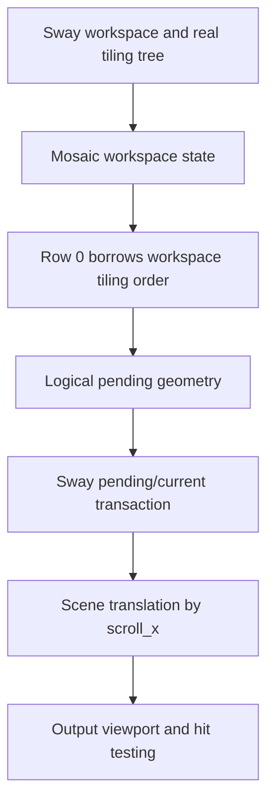

# Architecture

This is the canonical technical contract for SwayFX Mosaic. The current implementation is an experimental single-row compositor layout. [UX](UX.md) specifies user-visible behavior; [known limitations](KNOWN_LIMITATIONS.md) identifies unvalidated boundaries.

## Scope and authority

| System | Responsibility |
| --- | --- |
| SwayFX Mosaic compositor | Runtime order, geometry, focus, camera, scene, input, transactions, IPC |
| User dotfiles | Session selection and personal key bindings |
| QuickShell | Future visualization and controls through compositor IPC; never a layout authority |
| Session V2 | Future persistence/restoration helper; never a parallel runtime authority |
| SwayFX upstream | Base compositor and standard SwayFX behavior; maintained separately |

**The compositor is the runtime source of truth for Mosaic state.** A consumer may request a change or save a snapshot, but must not maintain an independent authoritative window arrangement.

## Runtime model and lifetime

The C model uses `struct mosaic_workspace_state`, `struct mosaic_row`, and `struct mosaic_row_state` (see `include/sway/tree/mosaic.h`). A workspace owns its Mosaic state and frees it with the workspace. The state owns row objects but never Sway containers. Row 0 borrows `workspace->tiling`, preserving the Sway tree's real ordered containers. Later model rows own their lists, not their children; they are **not** connected to runtime arrangement yet. A workspace also stores `mosaic_previous_standard_layout` separately from Sway's generic split-layout history.

## Distinct state

- **Logical order:** sequence in `workspace->tiling` for Row 0. Order is not inferred from screen coordinates.
- **Row membership:** only Row 0 is a runtime row today; multiple runtime rows are planned.
- **Geometry:** logical tiled rectangles in the workspace arrangement/transaction state. They may extend beyond the output width.
- **Camera:** row-local `scroll_x`, clamped to the arranged extent. It changes visibility without changing order.
- **Focus:** Sway's focus state, with a row-local remembered focused container. Focus can make an off-screen cell visible.
- **Standard-layout history:** workspace-local restore target for `layout toggle mosaic`.

Insertion after the active container and deletion reflow preserve contiguous logical order. Floating, fullscreen, and scratchpad retain Sway ownership and paths.

## Standard layout compatibility

`layout mosaic` activates the native layout on one workspace. `layout toggle mosaic` enters Mosaic or restores that workspace's previous standard layout. Windows keep Sway node identity. When a standard tabbed or stacking layout wraps workspace windows in a root container, entering Mosaic promotes its children into Row 0; deeper groups remain one logical cell. Standard layouts remain usable in the same binary. The restore path is a layout transition, not process replacement.

## Transactions and rendering

Sway's pending/current transaction model separates requested geometry from committed scene state. Mosaic calculates logical pending rectangles; scene positioning translates the tiling layer by `-scroll_x`. Camera updates and future animation must preserve agreement among committed scene positions, IPC geometry, and pointer hit testing. The current camera move is immediate; animated camera work is **PLANNED**.

The output renders a physical viewport of a wider logical row. Single-output headless tests demonstrate visual translation. A generic scene-tree clip at workspace/output boundaries is not yet implemented. Adjacent outputs may expose content outside a workspace's intended viewport; correct clipping and matching hit testing are a STEP20C concern. Do not infer multi-output safety from output-buffer cropping on one monitor.

## STEP20C viewport design status

The [STEP20C viewport proposal](design/STEP20C_VIEWPORT_DESIGN.md) audits the actual SwayFX/SceneFX paths and recommends a **PROPOSED** Mosaic-owned viewport projection with matching input boundary. It is not implemented or accepted as a frozen contract. SceneFX 0.5 has no public generic scene-tree clip API. The isolated [SceneFX clipping spike](design/STEP20C_SCENEFX_CLIPPING_SPIKE.md) demonstrated a private inherited clip for tiled descendants and matching pointer hits, but a real XDG popup escaped the viewport and intercepted input on the next output. Multi-output Mosaic remains unsupported until all visual, interactive, damage and packaging boundaries are demonstrated together.

The proposal distinguishes logical row order and computed geometry from the workspace viewport, logical camera target, and any future presented camera position. During a transaction, scene and pointer input must refer to the same applied geometry/viewport generation. The current `scroll_x` is not copied into Sway's transaction state; a future implementation must define that boundary explicitly. These are design requirements for STEP20C, not claims about current behavior.

The isolated [STEP20C feasibility probe](design/STEP20C_FEASIBILITY_PROBE.md) concluded **PARTIALLY FEASIBLE**. A disposable public-API surface clip did not reliably constrain all rendered content on two horizontal headless outputs, and a partly visible client received pointer enter outside the Mosaic viewport. The probe did not qualify decorations, effects, saved buffers or popups. Approach C remains proposed; production STEP20C implementation and general multi-output support are not authorized by this evidence.

The follow-up SceneFX subtree spike is also **PARTIALLY FEASIBLE**. It confirms that a tree-local render/hit clip can cover ordinary tiled descendants in an isolated binary, including pointer pass-through to another output. The globally parented popup path violates that boundary. Its temporary static link demonstrates a possible package shape, not a decided SceneFX dependency or ABI contract. The next design must bind popups to the owner's viewport without changing ordinary floating, fullscreen or standard-layout popup behavior.

The later [popup ownership probe](design/STEP20C_POPUP_OWNERSHIP_PROBE.md) demonstrated, in an isolated private build, a root-popup scene clip derived from the tiled owner’s applied Mosaic viewport. A tested nested popup inherited the clip; sampled visible popup input worked and the clipped-away popup did not intercept the ordinary client on the adjacent output. Standard `splith` behavior was restored after layout exit. Valid-serial XDG grabs and fully hidden popup owners were untested in that probe; additional output geometries, complete damage/effect coverage and package maintenance also remained unresolved. This evidence does not authorize production STEP20C or multi-output Mosaic support.

The [valid-grab and hidden-owner probe](design/STEP20C_VALID_GRAB_HIDDEN_OWNER_PROBE.md) measured a real button serial passed to `xdg_popup.grab` and compared unmodified SwayFX, private standard layout and private Mosaic. It found that the initial viewport-only popup clip leaked pixels and hits when the owner was entirely offscreen. A further disposable guard based on the owner's applied scene visibility suppressed the sampled leak while preserving the popup for camera return. The private guard does not establish a production transaction-generation contract, offscreen-popup UX policy or SceneFX ABI/package decision; broader STEP20C gates remain open.

The [preserved source fixture](../tooling/probes/step20c-valid-grab/README.md) reconstructs the private guard from pinned bases and patches. It supplies reproducible evidence, not a compositor-owned STEP20C implementation.

The subsequent [nested valid-grab probe](design/STEP20C_NESTED_VALID_GRAB_PROBE.md)
used two real pointer-button serials and a true toplevel → popup A → popup B
XDG parent chain. In a disposable guarded binary, both popup levels were
interactive within the horizontal two-output Mosaic viewport, absent from
sampled clipped visual/input positions, and restored after a fully hidden
owner returned without popup re-creation. The unmodified SwayFX and private
standard-layout controls preserved ordinary sampled popup behavior. This
narrows the feasibility gap for nested grabs but does not define a production
transaction, damage, output-geometry or SceneFX ABI contract.

The [vertical-output nested-grab probe](design/STEP20C_VERTICAL_OUTPUT_NESTED_GRAB_PROBE.md)
then placed HEADLESS-2 below HEADLESS-1 and used a parameterized private
virtual pointer. Unmodified SwayFX and private `splith` both rendered and
received input on A/B popup portions actually crossing `y=600`; the guarded
private Mosaic build omitted those sampled lower pixels and popup hits while
preserving upper interaction. A hidden owner returned with the same mapped
popups, and `splith` restored the sampled ordinary lower-output behavior.
This is vertical popup evidence only. The production compositor still has no
qualified cross-output viewport clip or committed scene/transaction contract.

The [negative-origin nested-grab probe](design/STEP20C_NEGATIVE_ORIGIN_NESTED_GRAB_PROBE.md)
measured HEADLESS-1 at `(-800,0)` and HEADLESS-2 at `(0,0)` in both standard
controls and private Mosaic. In the pinned wlroots path, the virtual-pointer
absolute fraction maps through the signed output-layout box; the runner
verified that `global_x+800` reaches the requested output and client surface.
The disposable applied SceneFX clip and popup-owner guard excluded sampled
right-output A/B pixels and hits, while standard layouts retained real
crossing and popup buttons. A fully hidden applied owner and return to
`splith` also passed at measured points. This remains experimental evidence:
production viewport clipping, transaction consistency, continuous damage
coverage and SceneFX ABI ownership are not settled.

The later [temporal damage probe](design/STEP20C_TEMPORAL_DAMAGE_PROBE.md)
kept that same negative-origin geometry and repeated genuine nested XDG
open/close cycles, camera hide/return and outside dismissal. Sampled private
Mosaic captures restored former popup regions without ghost pixels; the
private standard layout repeated control behavior. Timed SceneFX damage
extents and private SwayFX output-commit records covered changed pixels in
sampled capture intervals, but neither the extents nor accepted commits
identify all presented frames. The current Mosaic `scroll_x` still lacks a
native transaction-generation contract binding applied scene, clip and hit
testing. The temporal evidence is **PARTIALLY_FEASIBLE**, not a production
rendering or ABI guarantee.

## IPC

On a Mosaic workspace, `get_tree` reports `layout: "mosaic"` and adds a `mosaic` object with `active_row` and `rows`. Each row entry contains ordered child node IDs, `scroll_x`, and focused node ID or null. Existing Sway fields retain their shapes; normal workspace/window events and `get_workspaces` paths remain in use. This is an extension to the Sway layout vocabulary: strict IPC consumers with a closed layout enum must recognize `mosaic`. Additional rows in the model are not a promise of usable multi-row IPC behavior.

## Package and persistence boundary

The ordinary SwayFX package owns `/usr/bin/sway`; Mosaic owns the alternate `/usr/bin/swayfx-mosaic`. This is a pinned compositor build with a Mosaic patch, not a runtime plugin. [Packaging](PACKAGING.md) specifies coexistence and file ownership.

Session V2 restoration is **PLANNED**. It must restore Mosaic activation, ordered rows, row membership, active row, camera positions, remembered focus, and stable window identities through compositor-owned state. It must not become another source of runtime truth.

## Non-goals

- Replacing Sway workspaces or standard layouts.
- Replacing QuickShell or creating a new desktop shell.
- Simulating tiling with floating windows or a repositioning daemon.
- Embedding personal dotfiles or keyboard bindings in the package.
- Maintaining a permanently diverged SwayFX fork instead of a reviewable delta.
