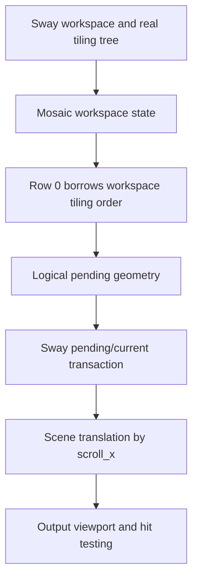

# Architecture

This is the canonical technical contract for SwayFX Mosaic. The current implementation is an experimental single-row compositor layout. [UX](UX.md) specifies user-visible behavior; [known limitations](KNOWN_LIMITATIONS.md) identifies unvalidated boundaries.

## Scope and authority

| System | Responsibility |
| --- | --- |
| SwayFX Mosaic compositor | Runtime order, geometry, focus, camera, scene, input, transactions, IPC |
| User dotfiles | Session selection and personal key bindings |
| QuickShell | Future visualization and controls through compositor IPC; never a layout authority |
| Session V2 | Future persistence/restoration helper; never a parallel runtime authority |
| SwayFX upstream | Base compositor and standard SwayFX behavior; maintained separately |

**The compositor is the runtime source of truth for Mosaic state.** A consumer may request a change or save a snapshot, but must not maintain an independent authoritative window arrangement.

## Runtime model and lifetime

The C model uses `struct mosaic_workspace_state`, `struct mosaic_row`, and `struct mosaic_row_state` (see `include/sway/tree/mosaic.h`). A workspace owns its Mosaic state and frees it with the workspace. The state owns row objects but never Sway containers. Row 0 borrows `workspace->tiling`, preserving the Sway tree's real ordered containers. Later model rows own their lists, not their children; they are **not** connected to runtime arrangement yet. A workspace also stores `mosaic_previous_standard_layout` separately from Sway's generic split-layout history.

## Distinct state

- **Logical order:** sequence in `workspace->tiling` for Row 0. Order is not inferred from screen coordinates.
- **Row membership:** only Row 0 is a runtime row today; multiple runtime rows are planned.
- **Geometry:** logical tiled rectangles in the workspace arrangement/transaction state. They may extend beyond the output width.
- **Camera:** row-local `scroll_x`, clamped to the arranged extent. It changes visibility without changing order.
- **Focus:** Sway's focus state, with a row-local remembered focused container. Focus can make an off-screen cell visible.
- **Standard-layout history:** workspace-local restore target for `layout toggle mosaic`.

Insertion after the active container and deletion reflow preserve contiguous logical order. Floating, fullscreen, and scratchpad retain Sway ownership and paths.

## Standard layout compatibility

`layout mosaic` activates the native layout on one workspace. `layout toggle mosaic` enters Mosaic or restores that workspace's previous standard layout. Windows keep Sway node identity. When a standard tabbed or stacking layout wraps workspace windows in a root container, entering Mosaic promotes its children into Row 0; deeper groups remain one logical cell. Standard layouts remain usable in the same binary. The restore path is a layout transition, not process replacement.

## Transactions and rendering

Sway's pending/current transaction model separates requested geometry from committed scene state. Mosaic calculates logical pending rectangles; scene positioning translates the tiling layer by `-scroll_x`. Camera updates and future animation must preserve agreement among committed scene positions, IPC geometry, and pointer hit testing. The current camera move is immediate; animated camera work is **PLANNED**.

The output renders a physical viewport of a wider logical row. Single-output headless tests demonstrate visual translation. A generic scene-tree clip at workspace/output boundaries is not yet implemented. Adjacent outputs may expose content outside a workspace's intended viewport; correct clipping and matching hit testing are a STEP20C concern. Do not infer multi-output safety from output-buffer cropping on one monitor.

## STEP20C viewport design status

The [STEP20C viewport proposal](design/STEP20C_VIEWPORT_DESIGN.md) audits the actual SwayFX/SceneFX paths and recommends a **PROPOSED** Mosaic-owned viewport projection with matching input boundary. It is not implemented or accepted as a frozen contract. SceneFX 0.5 has no public generic scene-tree clip API. The isolated [SceneFX clipping spike](design/STEP20C_SCENEFX_CLIPPING_SPIKE.md) demonstrated a private inherited clip for tiled descendants and matching pointer hits, but a real XDG popup escaped the viewport and intercepted input on the next output. Multi-output Mosaic remains unsupported until all visual, interactive, damage and packaging boundaries are demonstrated together.

The proposal distinguishes logical row order and computed geometry from the workspace viewport, logical camera target, and any future presented camera position. During a transaction, scene and pointer input must refer to the same applied geometry/viewport generation. The current `scroll_x` is not copied into Sway's transaction state; a future implementation must define that boundary explicitly. These are design requirements for STEP20C, not claims about current behavior.

The isolated [STEP20C feasibility probe](design/STEP20C_FEASIBILITY_PROBE.md) concluded **PARTIALLY FEASIBLE**. A disposable public-API surface clip did not reliably constrain all rendered content on two horizontal headless outputs, and a partly visible client received pointer enter outside the Mosaic viewport. The probe did not qualify decorations, effects, saved buffers or popups. Approach C remains proposed; production STEP20C implementation and general multi-output support are not authorized by this evidence.

The follow-up SceneFX subtree spike is also **PARTIALLY FEASIBLE**. It confirms that a tree-local render/hit clip can cover ordinary tiled descendants in an isolated binary, including pointer pass-through to another output. The globally parented popup path violates that boundary. Its temporary static link demonstrates a possible package shape, not a decided SceneFX dependency or ABI contract. The next design must bind popups to the owner's viewport without changing ordinary floating, fullscreen or standard-layout popup behavior.

The later [popup ownership probe](design/STEP20C_POPUP_OWNERSHIP_PROBE.md) demonstrated, in an isolated private build, a root-popup scene clip derived from the tiled owner’s applied Mosaic viewport. A tested nested popup inherited the clip; sampled visible popup input worked and the clipped-away popup did not intercept the ordinary client on the adjacent output. Standard `splith` behavior was restored after layout exit. Valid-serial XDG grabs and fully hidden popup owners were untested in that probe; additional output geometries, complete damage/effect coverage and package maintenance also remained unresolved. This evidence does not authorize production STEP20C or multi-output Mosaic support.

The [valid-grab and hidden-owner probe](design/STEP20C_VALID_GRAB_HIDDEN_OWNER_PROBE.md) measured a real button serial passed to `xdg_popup.grab` and compared unmodified SwayFX, private standard layout and private Mosaic. It found that the initial viewport-only popup clip leaked pixels and hits when the owner was entirely offscreen. A further disposable guard based on the owner's applied scene visibility suppressed the sampled leak while preserving the popup for camera return. The private guard does not establish a production transaction-generation contract, offscreen-popup UX policy or SceneFX ABI/package decision; broader STEP20C gates remain open.

The [preserved source fixture](../tooling/probes/step20c-valid-grab/README.md) reconstructs the private guard from pinned bases and patches. It supplies reproducible evidence, not a compositor-owned STEP20C implementation.

The subsequent [nested valid-grab probe](design/STEP20C_NESTED_VALID_GRAB_PROBE.md)
used two real pointer-button serials and a true toplevel → popup A → popup B
XDG parent chain. In a disposable guarded binary, both popup levels were
interactive within the horizontal two-output Mosaic viewport, absent from
sampled clipped visual/input positions, and restored after a fully hidden
owner returned without popup re-creation. The unmodified SwayFX and private
standard-layout controls preserved ordinary sampled popup behavior. This
narrows the feasibility gap for nested grabs but does not define a production
transaction, damage, output-geometry or SceneFX ABI contract.

The [vertical-output nested-grab probe](design/STEP20C_VERTICAL_OUTPUT_NESTED_GRAB_PROBE.md)
then placed HEADLESS-2 below HEADLESS-1 and used a parameterized private
virtual pointer. Unmodified SwayFX and private `splith` both rendered and
received input on A/B popup portions actually crossing `y=600`; the guarded
private Mosaic build omitted those sampled lower pixels and popup hits while
preserving upper interaction. A hidden owner returned with the same mapped
popups, and `splith` restored the sampled ordinary lower-output behavior.
This is vertical popup evidence only. The production compositor still has no
qualified cross-output viewport clip or committed scene/transaction contract.

The [negative-origin nested-grab probe](design/STEP20C_NEGATIVE_ORIGIN_NESTED_GRAB_PROBE.md)
measured HEADLESS-1 at `(-800,0)` and HEADLESS-2 at `(0,0)` in both standard
controls and private Mosaic. In the pinned wlroots path, the virtual-pointer
absolute fraction maps through the signed output-layout box; the runner
verified that `global_x+800` reaches the requested output and client surface.
The disposable applied SceneFX clip and popup-owner guard excluded sampled
right-output A/B pixels and hits, while standard layouts retained real
crossing and popup buttons. A fully hidden applied owner and return to
`splith` also passed at measured points. This remains experimental evidence:
production viewport clipping, transaction consistency, continuous damage
coverage and SceneFX ABI ownership are not settled.

The later [temporal damage probe](design/STEP20C_TEMPORAL_DAMAGE_PROBE.md)
kept that same negative-origin geometry and repeated genuine nested XDG
open/close cycles, camera hide/return and outside dismissal. Sampled private
Mosaic captures restored former popup regions without ghost pixels; the
private standard layout repeated control behavior. Timed SceneFX damage
extents and private SwayFX output-commit records covered changed pixels in
sampled capture intervals, but neither the extents nor accepted commits
identify all presented frames. The current Mosaic `scroll_x` still lacks a
native transaction-generation contract binding applied scene, clip and hit
testing. The temporal evidence is **PARTIALLY_FEASIBLE**, not a production
rendering or ABI guarantee.

The [presentation identity probe](design/STEP20C_PRESENTATION_IDENTITY_PROBE.md)
then observed native wlroots 0.20.2 headless output commit and deferred
present callbacks in a separate private compositor. Each observed present
paired with its accepted native `(output, commit_seq)`, and a scene snapshot
inside each commit callback recorded the applied tiled position and clip.
Ten settled target transitions showed matching applied scene/clip values at
400 and 1280, while some faster command intervals had no commit. During
initial layout setup, a presented commit exposed logical camera 1760 with
applied scene and clip still at 1120; this reinforces the distinction between
requested and applied state. The applied scene and clip themselves agreed.
Headless present is an idle-delivered simulated event, and neither it nor
sampled `grim` images identify the pixels of that exact output-state buffer.
Pointer events remain a separate time-ordered stream. The result is
**PARTIALLY_FEASIBLE** and does not define a production transaction or
SceneFX ABI contract.

The subsequent private [output buffer identity probe](design/STEP20C_OUTPUT_BUFFER_IDENTITY_PROBE.md)
read sampled actual GBM output-state buffers through SceneFX FX texture
readback, after an audited wlroots 0.20.2 buffer lock. In the fixed
negative-origin headless matrix, 32 selected buffers matched their native
commit callback, `commit_seq` and headless present; their sampled A/B pixels
agreed with the applied tiled scene and clip at 400/1280. Three buffers were
read again while locked at present with identical bytes. Four other
selected locks were released before their later present events because a
HEADLESS-2 repaint reached a global release in the private probe. This is
an instrumentation scope defect, not a demonstrated replacement by a new
HEADLESS-1 submission. The initial
logical-1760/applied-1120 state also had an identified buffer and headless
present, without a demonstrated pixel or hit defect. This does not create a
production buffer API or transaction-generation contract. FX readback uses
an internal GPU synchronization and measurably delays the commit path;
frame-specific input consistency, other effects/renderers and physical
presentation remain unproven. The result is **PARTIALLY_FEASIBLE** and
multi-output Mosaic stays unsupported.

The [applied state/input probe](design/STEP20C_APPLIED_STATE_INPUT_PROBE.md)
then corrected the private buffer hold to be output-scoped. A sampled
HEADLESS-2 repaint between a retained HEADLESS-1 commit and its present
did not release that reference. Three selected visible/hidden/returned
buffers matched their applied scene/clip, native commits and headless
presents, and were reread byte-identically while locked. A private
experimental epoch marks some popup and transaction arrangement sites and
appears in both build and executed hit-test traces. It is not a native
atomic transaction generation and does not cover every render/input
mutation. Client delivery under a real XDG grab was checked separately
from the scene hit. This **PARTIALLY_FEASIBLE** result does not change
production scene, transaction, input or SceneFX ABI contracts.

The [mutation coverage probe](design/STEP20C_MUTATION_COVERAGE_PROBE.md)
audited compositor, private SceneFX and wlroots 0.20.2 mutation owners and
ran a bounded trace-only headless matrix. Camera/clip and popup lifecycle
observations agreed with scene hits and actual client events. A same-size
client recolor changed pixels while applied geometry and the partial epoch
stayed fixed; an empty surface input region changed the executed hit at the
same point and epoch without changing sampled pixels. Thus
`asi_applied_epoch` cannot identify all hit-relevant mutations. A native
output `(output, commit_seq)` records a submission, not the later input
state. Distinct geometry/hit, content and presentation identities are
candidate research boundaries; whether existing event-loop ordering alone
is enough across build, present and input remains **UNDECIDED**. No new
production generation or transaction contract is accepted by this probe.

The independently replayed [commit/present/input ordering probe](design/STEP20C_COMMIT_PRESENT_INPUT_ORDERING_PROBE.md)
confirms in source that wlroots headless queues `present` as an idle callback
after an accepted output commit, while an applied Wayland input-region
commit changes the region consulted by later scene hits. In five bounded
cycles per mode, all 20 applied target input mutations in private standard
and Mosaic occurred after the preceding matching `present`; none landed
inside a native commit-to-present interval. Input-only hit and client
delivery matched the effective region in sampled states. This leaves the
cross-time Mosaic clipping invariant **UNDECIDED** and adds no production
generation contract. A later hit may legitimately use newer input than a
previously committed output buffer; identity of these states must remain
distinct in further probes.

The follow-up private [event-loop pending-input probe](design/STEP20C_EVENT_LOOP_PENDING_INPUT_PROBE.md)
submitted ordinary client region requests without waiting for each camera or
rendering IPC response. All 20 target mutations applied in two instrumented
modes, but none occurred between a matching native headless output commit
and present. This is **INCONCLUSIVE** for the unexercised temporal case;
neither a Mosaic clipping violation nor the need for an additional applied
generation was demonstrated. Client flush, server application, submitted
buffer and later hit remain separate identities. The temporal line is closed
for this backend/matrix after five attempts per mode, while the overall
cross-time architectural question remains **UNDECIDED**.

## STEP20C effects and damage evidence

The [STEP20C effects/damage probe](design/STEP20C_EFFECTS_DAMAGE_PROBE.md)
used a private inherited SceneFX clip with genuinely visible translucent
blur and an ordinary shadow crossing the neighboring output. The sampled
Mosaic blur stayed on its output; the ordinary 27,594-pixel shadow spill
was absent there under Mosaic. Three settled hide/return pairs reproduced
the original pixels, and sampled private damage covered changed pixels.
The Mosaic interior shadow was not independently visible, while optimized
blur cache correctness, out-of-viewport source sampling, popup effects and
saved buffers remain unqualified. The private result is
**PARTIALLY_FEASIBLE** and does not establish a production rendering or
transaction contract. STEP20C remains **NEXT**; multi-output Mosaic remains
**NOT YET SUPPORTED**.

## IPC

On a Mosaic workspace, `get_tree` reports `layout: "mosaic"` and adds a `mosaic` object with `active_row` and `rows`. Each row entry contains ordered child node IDs, `scroll_x`, and focused node ID or null. Existing Sway fields retain their shapes; normal workspace/window events and `get_workspaces` paths remain in use. This is an extension to the Sway layout vocabulary: strict IPC consumers with a closed layout enum must recognize `mosaic`. Additional rows in the model are not a promise of usable multi-row IPC behavior.

## Package and persistence boundary

The ordinary SwayFX package owns `/usr/bin/sway`; Mosaic owns the alternate `/usr/bin/swayfx-mosaic`. This is a pinned compositor build with a Mosaic patch, not a runtime plugin. [Packaging](PACKAGING.md) specifies coexistence and file ownership.

Session V2 restoration is **PLANNED**. It must restore Mosaic activation, ordered rows, row membership, active row, camera positions, remembered focus, and stable window identities through compositor-owned state. It must not become another source of runtime truth.

## Non-goals

- Replacing Sway workspaces or standard layouts.
- Replacing QuickShell or creating a new desktop shell.
- Simulating tiling with floating windows or a repositioning daemon.
- Embedding personal dotfiles or keyboard bindings in the package.
- Maintaining a permanently diverged SwayFX fork instead of a reviewable delta.

Effects freeze audit: the historical campaign exceeded its three-pair budget
(15 pairs in five Mosaic runs); all evidence is retained. A separate fresh
rebuild reproduced the main counts with one pair under the corrected
campaign guard. The traced reference had a different effective size, so
instrumentation neutrality and its cause remain unqualified. See the
[effects report](design/STEP20C_EFFECTS_DAMAGE_PROBE.md). This adds no contract.

The preserved [fractional scaling probe](design/STEP20C_FRACTIONAL_SCALING_PROBE.md)
is **PARTIALLY_FEASIBLE** for static 1.25 uniform/mixed and 1.5 mixed headless
outputs. Actual modes/PNGs and logical pointer motion were calibrated. Sampled
root/nested popup and shadow spill disappeared on the neighboring output;
visible blur, terminal popup columns, two settled camera returns and available
physical damage were consistent. Opaque tiled-overflow controls, permitted
interior shadow, restored Mosaic hit, caches and intermediate frames remain
unqualified. Ten failed early calibrations and their source-provenance limit
are retained. The two-pair global budget was respected. The next distinct gate
should test resize/migration of owner/output clips; rotation, saved buffers and
ABI/package remain separate. This is evidence only: STEP20C stays **NEXT**,
production multi-output **NOT YET SUPPORTED**, STEP20D–G **PLANNED**.

The preserved [dynamic output ownership probe](design/STEP20C_DYNAMIC_OUTPUT_OWNERSHIP_PROBE.md)
is **PARTIALLY_FEASIBLE**: actual logical resize 800→960→800 and workspace
migration H1→H2→H1 retain workspace/tiled identities and update sampled applied
tiled/root-popup clips. Vacated outputs show exact background after stabilization.
Two standard controls fail final reference calibration through fixture occlusion;
Mosaic's corrected calibration passes. Maximum-scroll clamp, migrated clipped
popup input, independent opaque tiled spill, effects and intermediate frames
remain unqualified. Budgets are exhausted at six reconfigurations and six
migrations, with zero additional camera pairs. No production change follows.
Rotation is the next separate geometric gate; other open STEP20C gates persist.
The freeze audit verified the original evidence manifest before an offline
replay rewrote the temporary inventory; the report records that limitation.
STEP20C stays **NEXT**, multi-output **NOT YET SUPPORTED**.

The [rotated-output probe](design/STEP20C_ROTATED_OUTPUT_PROBE.md) is
**PARTIALLY_FEASIBLE** for sampled applied 90° geometry, logical PNG/pointer
calibration, fully hidden owner guard, physical damage coverage and R0 return.
The `grim` PNG is logical-oriented at 1000×750 while the R90 physical mode is
750×1000. Pristine R90 capture failed through a fixture IPC-direction error,
and the Mosaic B popup never reached the boundary, so partial popup clipping
under rotation remains **UNDECIDED**. No applied-geometry generation contract
or production behavior is accepted by this evidence.

The separate [static R90 partial-popup probe](design/STEP20C_ROTATED_PARTIAL_POPUP_CLIP_PROBE.md)
measured a real Mosaic B box crossing x=0 by 72 logical pixels, with B
visible/clickable inside H1 and absent visually and from client delivery on
H2. Its applied root clip and nested inheritance matched the H1 owner
viewport in the sampled state; pristine and private-standard controls both
drew and handled the crossed portion. Result **PARTIALLY_FEASIBLE** because
the clipped-away part of A was not independently clicked and no atomic
render/input generation was proved. The architecture remains experimental.

The local [saved transaction buffer probe](design/STEP20C_SAVED_TRANSACTION_BUFFER_PROBE.md)
found `saved_surface_tree` under `view->scene_tree` as a sibling of live
`content_tree`; SceneFX retains the source buffer at creation and a private
trace observed saved render entries and normal removal after ACK/timeout.
The experimental Mosaic tiled clip is an ancestor of the view tree, so a
saved tree has a plausible inherited path. The measured target was outside
H1 after the applied camera reached 1760, preventing a boundary-clipping
conclusion. This remains INCONCLUSIVE, with no production architecture change.

The separate [target-crossing saved-buffer probe](design/STEP20C_SAVED_BUFFER_TARGET_CROSSING_PROBE.md)
then measured the actual source and saved scene buffer crossing x=0 after a
single calculated camera correction. Its target saved node rendered with a
visible region ending at x=0 and retained target pixels on H1; no target SHM
color appeared on H2. A 253-pixel whole-H2 reference difference and incomplete
Mosaic timeout/input/damage/lifetime evidence limit the result to
PARTIALLY_FEASIBLE and architecture UNDECIDED. No production contract changes.
Offline freeze analysis strongly supports a blinking Kitty block cursor for
the repeated H2 reference difference, without proving its cause. E2's
`x=-30` visible bound matches the applied tiled clip narrowed by gaps; it is
not evidence of a distinct content clip. Target timeout cleanup remains open.

The separate [natural timeout and input gate](design/STEP20C_SAVED_TARGET_TIMEOUT_INPUT_PROBE.md)
uses a static SHM H2 reference and one Mosaic transaction. The actual target
source and saved node both crossed x=0; the saved node rendered only its H1
portion and its tree was removed after a real 2500 ms timeout with serial 50
held and the client alive. The whole H2 RGB image was identical across two
preflight, held and applied captures. Two sampled pointer positions found
the H2 reference surface and the visible H1 saved node respectively; the
latter is not a Wayland surface. This closes the sampled saved-target ACK and
timeout clipping matrix, **PARTIALLY_FEASIBLE**, without proving full damage,
all input paths or native GPU lifetime. The earlier crossing campaign's own
architectural verdict remains UNDECIDED. The new limited-matrix conclusion
does not authorize a production implementation. Optimized blur/cache and
SceneFX ABI/package remain separate gates.

The preserved [optimized blur cache probe](design/STEP20C_OPTIMIZED_BLUR_CACHE_PROBE.md)
is **PARTIALLY_FEASIBLE**, architecture **UNDECIDED**. A real background
layer under blur_tree triggered natural output-specific cache reconstruction
and fresh central A/B/A filtered pixels in private splith and Mosaic.
Sampled final tiled drawing excluded H2, whose whole RGB remained identical;
output damage extents covered stabilized differences and sampled cache/FBO
teardown completed. Shared boundary differences up to six RGB levels remain
unresolved. Pristine C0 failed before captures through a duplicate configure
fixture; its second initial image was reserved only after observation.
No numerical budget was exceeded or run repeated. Instrumentation neutrality,
whole-cache equivalence and intermediate frames remain unqualified. A
separate pristine/untraced boundary-sampling gate should precede ABI/package
qualification. This evidence freeze changes no production or UX contract.
STEP20C stays **NEXT**, multi-output **NOT YET SUPPORTED**.
