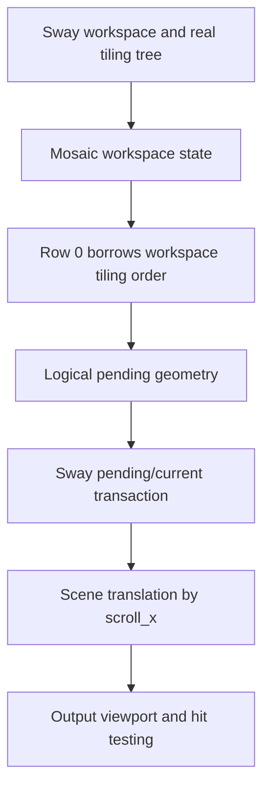

# Architecture

This is the canonical technical contract for SwayFX Mosaic. The current implementation is an experimental single-row compositor layout. [UX](UX.md) specifies user-visible behavior; [known limitations](KNOWN_LIMITATIONS.md) identifies unvalidated boundaries.

## Scope and authority

| System | Responsibility |
| --- | --- |
| SwayFX Mosaic compositor | Runtime order, geometry, focus, camera, scene, input, transactions, IPC |
| User dotfiles | Session selection and personal key bindings |
| QuickShell | Future visualization and controls through compositor IPC; never a layout authority |
| Session V2 | Future persistence/restoration helper; never a parallel runtime authority |
| SwayFX upstream | Base compositor and standard SwayFX behavior; maintained separately |

**The compositor is the runtime source of truth for Mosaic state.** A consumer may request a change or save a snapshot, but must not maintain an independent authoritative window arrangement.

## Runtime model and lifetime

The C model uses `struct mosaic_workspace_state`, `struct mosaic_row`, and `struct mosaic_row_state` (see `include/sway/tree/mosaic.h`). A workspace owns its Mosaic state and frees it with the workspace. The state owns row objects but never Sway containers. Row 0 borrows `workspace->tiling`, preserving the Sway tree's real ordered containers. Later model rows own their lists, not their children; they are **not** connected to runtime arrangement yet. A workspace also stores `mosaic_previous_standard_layout` separately from Sway's generic split-layout history.

## Distinct state

- **Logical order:** sequence in `workspace->tiling` for Row 0. Order is not inferred from screen coordinates.
- **Row membership:** only Row 0 is a runtime row today; multiple runtime rows are planned.
- **Geometry:** logical tiled rectangles in the workspace arrangement/transaction state. They may extend beyond the output width.
- **Camera:** row-local `scroll_x`, clamped to the arranged extent. It changes visibility without changing order.
- **Focus:** Sway's focus state, with a row-local remembered focused container. Focus can make an off-screen cell visible.
- **Standard-layout history:** workspace-local restore target for `layout toggle mosaic`.

Insertion after the active container and deletion reflow preserve contiguous logical order. Floating, fullscreen, and scratchpad retain Sway ownership and paths.

## Standard layout compatibility

`layout mosaic` activates the native layout on one workspace. `layout toggle mosaic` enters Mosaic or restores that workspace's previous standard layout. Windows keep Sway node identity. When a standard tabbed or stacking layout wraps workspace windows in a root container, entering Mosaic promotes its children into Row 0; deeper groups remain one logical cell. Standard layouts remain usable in the same binary. The restore path is a layout transition, not process replacement.

## Transactions and rendering

Sway's pending/current transaction model separates requested geometry from committed scene state. Mosaic calculates logical pending rectangles; scene positioning translates the tiling layer by `-scroll_x`. Camera updates and future animation must preserve agreement among committed scene positions, IPC geometry, and pointer hit testing. The current camera move is immediate; animated camera work is **PLANNED**.

The output renders a physical viewport of a wider logical row. Single-output headless tests demonstrate visual translation. A generic scene-tree clip at workspace/output boundaries is not yet implemented. Adjacent outputs may expose content outside a workspace's intended viewport; correct clipping and matching hit testing are a STEP20C concern. Do not infer multi-output safety from output-buffer cropping on one monitor.

## STEP20C viewport design status

The [STEP20C viewport proposal](design/STEP20C_VIEWPORT_DESIGN.md) audits the actual SwayFX/SceneFX paths and recommends a **PROPOSED** Mosaic-owned viewport projection with matching input boundary. It is not implemented or accepted as a frozen contract. SceneFX 0.5 has no public generic scene-tree clip API; the proposed node-specific projection still needs a focused headless feasibility probe covering effects, saved buffers, popups, damage and hit testing. Multi-output Mosaic remains unsupported until visual and interactive isolation are demonstrated together.

The proposal distinguishes logical row order and computed geometry from the workspace viewport, logical camera target, and any future presented camera position. During a transaction, scene and pointer input must refer to the same applied geometry/viewport generation. The current `scroll_x` is not copied into Sway's transaction state; a future implementation must define that boundary explicitly. These are design requirements for STEP20C, not claims about current behavior.

## IPC

On a Mosaic workspace, `get_tree` reports `layout: "mosaic"` and adds a `mosaic` object with `active_row` and `rows`. Each row entry contains ordered child node IDs, `scroll_x`, and focused node ID or null. Existing Sway fields retain their shapes; normal workspace/window events and `get_workspaces` paths remain in use. This is an extension to the Sway layout vocabulary: strict IPC consumers with a closed layout enum must recognize `mosaic`. Additional rows in the model are not a promise of usable multi-row IPC behavior.

## Package and persistence boundary

The ordinary SwayFX package owns `/usr/bin/sway`; Mosaic owns the alternate `/usr/bin/swayfx-mosaic`. This is a pinned compositor build with a Mosaic patch, not a runtime plugin. [Packaging](PACKAGING.md) specifies coexistence and file ownership.

Session V2 restoration is **PLANNED**. It must restore Mosaic activation, ordered rows, row membership, active row, camera positions, remembered focus, and stable window identities through compositor-owned state. It must not become another source of runtime truth.

## Non-goals

- Replacing Sway workspaces or standard layouts.
- Replacing QuickShell or creating a new desktop shell.
- Simulating tiling with floating windows or a repositioning daemon.
- Embedding personal dotfiles or keyboard bindings in the package.
- Maintaining a permanently diverged SwayFX fork instead of a reviewable delta.
