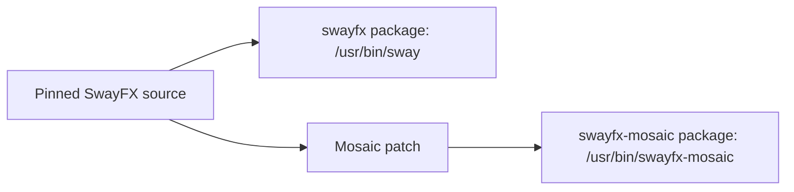

# Packaging and coexistence

This is the canonical package contract. **SwayFX updates must never be blocked by swayfx-mosaic.** The package is experimental; staging and package checks are development validation, not a daily-use endorsement.

## Why a second compositor binary?

SwayFX does not expose a stable external layout plugin ABI. A native layout must be compiled into a compositor variant. The maintained project delta is the Mosaic patch on a pinned SwayFX source revision, while the resulting binary contains the compositor. A separate package is **not** a runtime plugin or injected `.so`.

## Ownership and fallback

The regular `swayfx` package owns `/usr/bin/sway` and its normal files. `swayfx-mosaic` must own only its distinct binary and any future project-specific files. The current `PKGBUILD` checks that staging contains exactly `/usr/bin/swayfx-mosaic`. It must not install Sway's config, `swaymsg`, `swaybar`, `swaynag`, shared completion files, personal dotfiles, QuickShell config, or a conflicting session file.

The Mosaic package must not declare `provides`, `conflicts`, or `replaces` against SwayFX or Sway. The normal SwayFX session remains available as a fallback; selecting Mosaic is an explicit external session choice. Removing Mosaic must leave ordinary SwayFX intact.

The isolated [SceneFX subtree clipping spike](design/STEP20C_SCENEFX_CLIPPING_SPIKE.md) built and ran a statically linked private SceneFX example, but it did not approve a new production dependency, bundled library or package manifest. Popup clipping and SceneFX/wlroots ABI and update maintenance remain unresolved. The current package continues to use the system SceneFX dependency and the one-binary staging rule above.

## Version and source pin

Versions identify the SwayFX base and Mosaic revision, for example `swayfx 0.6` and `swayfx-mosaic 0.6+mosaic.1`. The current package pins SwayFX tag `0.6` at `fd71a6bdc061bd633b488ae7b83e8a6981d22f86`, then applies `patches/0001-mosaic-layout-viewport.patch`. The recipe checks the fetched commit and patch applicability before building. An upstream `0.7` release does not make the current patch valid for `0.7`.

The repository contains full source for development. The exporter constructs the cumulative patch from the verified pristine SwayFX 0.6 import, checks forward and reverse application and source equivalence, then atomically replaces the artifact. A patch must match its pinned upstream commit and recorded `PKGBUILD` checksum; forced or silent patch application is forbidden. See the exact offline export and independent clean-source verification procedure in [Development](DEVELOPMENT.md). Successful export alone is not package qualification.

## Arch package expectations

`PKGBUILD` uses the pinned Git source, the Mosaic patch, and the headless test script. It builds with `-Dmosaic-package=true` and runs Meson and headless tests. Validate source metadata with `makepkg --printsrcinfo` and `makepkg --verifysource`; perform a full package build before release. Inspect the staged file manifest before any install. A package build does not authorize switching the running session.

## Upgrade and rollback

1. Keep normal `swayfx` installed and independently updatable.
2. On a new SwayFX release, fetch and inspect upstream; create a dedicated forward-port branch.
3. Adapt the patch manually, update the pin/version/checksum, and test both the pristine baseline and Mosaic.
4. Recheck standard layouts, Mosaic, headless rendering, IPC, and package file ownership.
5. Publish only after the new base has been validated. Until then, the older pinned Mosaic package may remain available separately; it must not constrain normal SwayFX updates.
6. If Mosaic fails, use the normal SwayFX session. Do not overwrite `/usr/bin/sway` to recover.

See [upstream maintenance](UPSTREAM.md) and [development](DEVELOPMENT.md) for the operational procedure.
