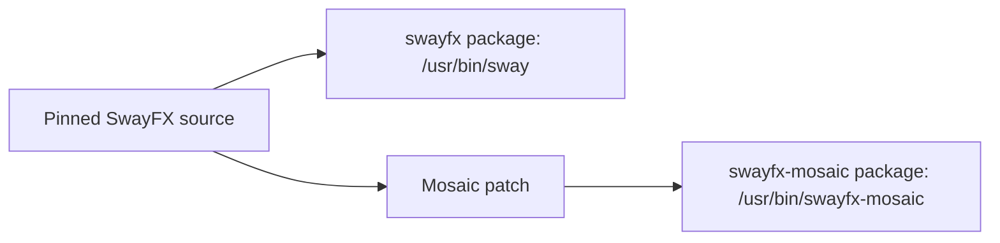

# Packaging and coexistence

This is the canonical package contract. **SwayFX updates must never be blocked by swayfx-mosaic.** The package is experimental; staging and package checks are development validation, not a daily-use endorsement.

## Why a second compositor binary?

SwayFX does not expose a stable external layout plugin ABI. A native layout must be compiled into a compositor variant. The maintained project delta is the Mosaic patch on a pinned SwayFX source revision, while the resulting binary contains the compositor. A separate package is **not** a runtime plugin or injected `.so`.

## Ownership and fallback

The regular `swayfx` package owns `/usr/bin/sway` and its normal files. `swayfx-mosaic` must own only its distinct binary and any future project-specific files. The current `PKGBUILD` checks that staging contains exactly `/usr/bin/swayfx-mosaic`. It must not install Sway's config, `swaymsg`, `swaybar`, `swaynag`, shared completion files, personal dotfiles, QuickShell config, or a conflicting session file.

The Mosaic package must not declare `provides`, `conflicts`, or `replaces` against SwayFX or Sway. The normal SwayFX session remains available as a fallback; selecting Mosaic is an explicit external session choice. Removing Mosaic must leave ordinary SwayFX intact.

The isolated [SceneFX subtree clipping spike](design/STEP20C_SCENEFX_CLIPPING_SPIKE.md) built and ran a statically linked private SceneFX example, but it did not approve a new production dependency, bundled library or package manifest. Popup clipping and SceneFX/wlroots ABI and update maintenance remain unresolved. The current package continues to use the system SceneFX dependency and the one-binary staging rule above.

## Version and source pin

Versions identify the SwayFX base and Mosaic revision, for example `swayfx 0.6` and `swayfx-mosaic 0.6+mosaic.1`. The current package pins SwayFX tag `0.6` at `fd71a6bdc061bd633b488ae7b83e8a6981d22f86`, then applies `patches/0001-mosaic-layout-viewport.patch`. The recipe checks the fetched commit and patch applicability before building. An upstream `0.7` release does not make the current patch valid for `0.7`.

The repository contains full source for development. The exporter constructs the cumulative patch from the verified pristine SwayFX 0.6 import, checks forward and reverse application and source equivalence, then atomically replaces the artifact. A patch must match its pinned upstream commit and recorded `PKGBUILD` checksum; forced or silent patch application is forbidden. See the exact offline export and independent clean-source verification procedure in [Development](DEVELOPMENT.md). Successful export alone is not package qualification.

## Arch package expectations

`PKGBUILD` uses the pinned Git source, the Mosaic patch, and the headless test script. It builds with `-Dmosaic-package=true` and runs Meson and headless tests. Validate source metadata with `makepkg --printsrcinfo` and `makepkg --verifysource`; perform a full package build before release. Inspect the staged file manifest before any install. A package build does not authorize switching the running session.

## Upgrade and rollback

1. Keep normal `swayfx` installed and independently updatable.
2. On a new SwayFX release, fetch and inspect upstream; create a dedicated forward-port branch.
3. Adapt the patch manually, update the pin/version/checksum, and test both the pristine baseline and Mosaic.
4. Recheck standard layouts, Mosaic, headless rendering, IPC, and package file ownership.
5. Publish only after the new base has been validated. Until then, the older pinned Mosaic package may remain available separately; it must not constrain normal SwayFX updates.
6. If Mosaic fails, use the normal SwayFX session. Do not overwrite `/usr/bin/sway` to recover.

See [upstream maintenance](UPSTREAM.md) and [development](DEVELOPMENT.md) for the operational procedure.

## Preserved experimental ABI/package audit

The [STEP20C audit](design/STEP20C_SCENEFX_ABI_PACKAGE_FEASIBILITY.md) separately
validates the unchanged current package's stock build and exact-one-file stage.
The experimental shared binary cannot resolve its two private clip functions
with stock SceneFX. A private static build removes SceneFX DT_NEEDED, but does
not establish shared-wlroots update safety or a one-file notice policy.
A distinct private dynamic library would add an owned file and require a new
explicit packaging decision. No option is adopted; the contract above remains
authoritative and unchanged. The historical evidence is frozen, PARTIALLY_FEASIBLE.

## Preserved static distribution contract evidence

The [static dossier](design/STEP20C_SCENEFX_STATIC_DISTRIBUTION_CONTRACT.md)
records STATIC_STAGE_FILE_SHAPE_PASS from one private stage, with no library
or notice file installed. It proposes dependency/security/version/notice
policies, without changing this package contract or PKGBUILD. Embedded notices
are technically extractable in a disposable copy; complete/legal delivery is
unqualified. A separate installed notice (N3) would need an explicit user
decision changing the exact-one-file rule. PARTIALLY_FEASIBLE; no production
strategy adopted. The historical evidence is preserved; it does not authorize production integration.

## Approved private STEP20C static candidate — 2026-10-13

The user approved four decisions for documentation and private prototypes only:
private static SceneFX; separate complete notices under
`/usr/share/licenses/swayfx-mosaic/`; project responsibility for embedded
SceneFX maintenance; and qualification of each exact SceneFX/wlroots pair.
See the [decision register and bounded runtime gate](design/STEP20C_STATIC_RUNTIME_AND_PACKAGE_CONTRACT.md).
The current PKGBUILD, system SceneFX dependency, one-binary package, production
sources and cumulative patch remain unchanged. The future private stage may
contain only `/usr/bin/swayfx-mosaic` and justified regular notice files below
the license directory. No private shared library, session, service, config or
Sway symlink is allowed. No real installation is authorized.

Mosaic owns monitoring, impact review, rebuild and requalification of embedded
SceneFX fixes, including renderer/shaders/dependencies/ABI/buffer lifetime/clip/
damage changes. Before public distribution, a release maintainer and security
reviewer must be designated; no names or SLA are assigned. Preserve exact source,
patch, compiler/options/dependency, notice, test and artifact manifests.
A new relevant dependency build requires header/symbol/shared-layout inspection,
rebuild, relocation/model/staging/headless checks and graphical requalification
of relevant paths, then a separate publication decision. No automatic update
subsystem is added. Ordinary SwayFX upgrades remain independent and standard
SwayFX remains the fallback. All other pairs are NOT QUALIFIED.

These decisions do not settle popup UX or close STEP20C production gates.
STEP20A DONE; STEP20B EXPERIMENTAL; STEP20C NEXT; STEP20D–G PLANNED.
Production multi-output remains NOT YET SUPPORTED.

Measured private candidate staging: one real `/usr` binary plus four justified
notice files, STATIC_STAGE_WITH_LICENSES=PASS. This does not change the current
recipe, certify legal distribution closure or qualify runtime input/standard
return. See the linked private gate for complete failed/untested cells.
